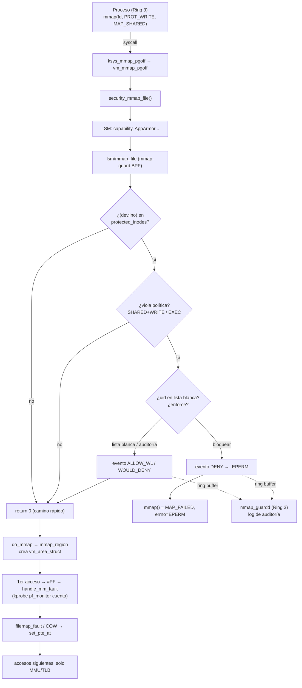

# Arquitectura de mmap-guard

## Idea central

Después del primer page fault, la MMU atiende los accesos a una región mapeada **sin pasar
por el kernel**. Por eso mmap-guard no intenta inspeccionar cada acceso: **controla los
momentos en que se otorgan permisos** sobre la memoria respaldada por un archivo protegido:

1. al crear el mapeo (`mmap` → hook LSM `mmap_file`),
2. al cambiar permisos (`mprotect` → hook LSM `file_mprotect`),

y **mide** los faults (`handle_mm_fault`) para cuantificar el costo y observar COW.

## Componentes

| Componente | Capa | Archivo | Rol |
|---|---|---|---|
| Hooks eBPF-LSM | Ring 0 | `bpf/mmap_guard.bpf.c` | Decide ALLOW/DENY, cuenta y audita |
| Tipos compartidos | — | `bpf/mmap_guard.h` | Clave (dev, ino), evento, políticas |
| Loader `mmap_guardd` | Ring 3 | `loader/mmap_guardd.c` | Carga BPF, traduce rutas → inodes, imprime auditoría |
| LKM `pf_monitor` | Ring 0 | `lkm/pf_monitor.c` | kprobe en `handle_mm_fault` + modo respaldo con kretprobes |
| Pruebas y bench | Ring 3 | `tests/` | Ataques controlados, integridad por hash, overhead |

## Flujo de decisión

`mprotect()` sigue el mismo esquema: `do_mprotect_pkey()` → chequeo `VM_MAY*` del kernel →
`security_file_mprotect()` → `lsm/file_mprotect` → (si se permite) `mprotect_fixup()`.

## Políticas

| Directiva (`protected.conf`) | Bits | Bloquea |
|---|---|---|
| `protect <ruta>` | `NO_SHARED_WRITE \| NO_MPROTECT_UP` | `mmap(PROT_WRITE, MAP_SHARED[_VALIDATE])`, `mprotect(+W)` en VMA compartido, `mprotect(+X)` |
| `noexec <ruta>` | `NO_EXEC \| NO_MPROTECT_UP` | `mmap(PROT_EXEC)`, `mprotect(+X)` |
| `allow_uid <uid>` | — | nada: audita como `ALLOW_WL` |

Se permite siempre: lectura compartida o privada y escritura privada (COW), porque no
modifican el archivo (ver `docs/preguntas-diagnosticas.md`, preguntas 2 y 8).

## Decisiones de diseño

- **Identidad por (dev, inode), no por ruta.** Las rutas se evaden con hardlinks, symlinks,
  bind mounts, `/proc/self/fd/N` o renombrando. El inode es el objeto real que respalda el VMA.
  El loader convierte `st_dev` (formato glibc) al formato interno `MKDEV` (`MAJOR<<20|MINOR`).
  En btrfs/overlayfs ese valor no coincide con `i_sb->s_dev`, así que existe el comodín
  `dev = 0` (opción `-i`).
- **Decidir antes de crear el VMA.** `security_mmap_file()` corre antes de `do_mmap()`: no hay
  estado que deshacer, ni PTEs, ni páginas.
- **La auditoría no condiciona la seguridad.** Si el ring buffer se llena el evento se pierde,
  pero la decisión ya se tomó; los contadores per-CPU no pierden nada.
- **Respetar la cadena LSM.** Si un LSM anterior negó (`ret != 0`), se devuelve su código.
- **Dos mecanismos.** BPF-LSM es el principal. Si el kernel no tiene `bpf` en la lista de LSM
  (caso OrbStack, donde no se controla el arranque), `pf_monitor enforce=1` aplica la misma
  política con kretprobes sobre los wrappers `security_*`.
- **Sin técnicas inseguras.** No se toca `sys_call_table`, no se desactiva el bit WP de CR0, no
  se usa `kallsyms_lookup_name`.
